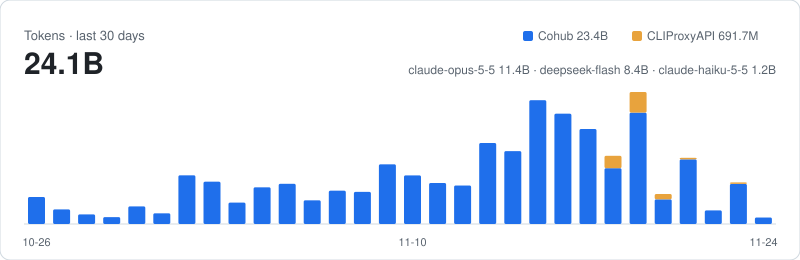

<table align="center" border="0" cellpadding="0" cellspacing="0">
  <tr>
    <td width="600" valign="top">
      <h1>Hello, I'm markbang/bangwu</h1>
      
<b>Developer | Tech Enthusiast | Explorer</b>

      <!-- 

        
        
      
 -->
      <a href="https://bangwu.me">
        blog
      </a>
      |
      <a href="https://base.bangwu.me">
        knowledge base  
      <a/>
      |
      <a href="https://now.bangwu.me">
        now  
      <a/>
    </td>
    <td width="250" align="center">
      
    </td>
  </tr>
</table>

### Token Usage

  <picture>
    <source media="(prefers-color-scheme: dark)" srcset="./assets/token-usage-dark.svg">
    
  </picture>

---

### 🛠 Tech Stack

  <picture>
    
  </picture>

